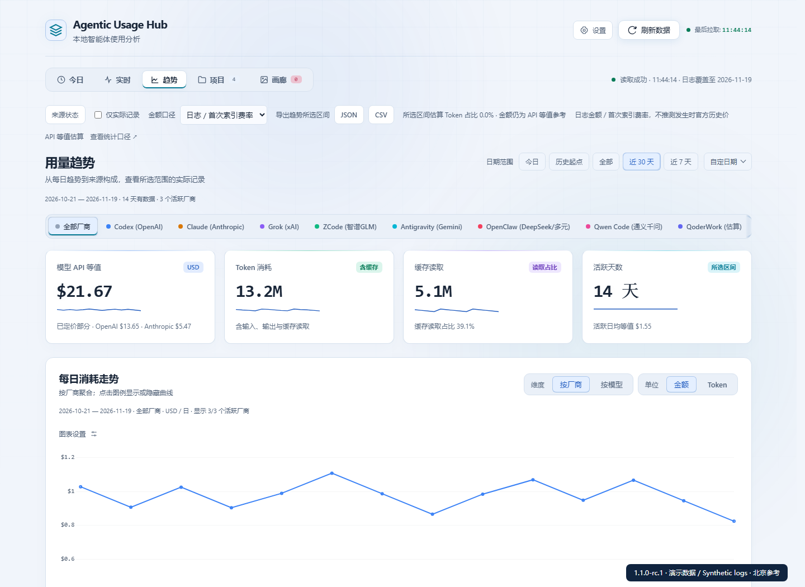
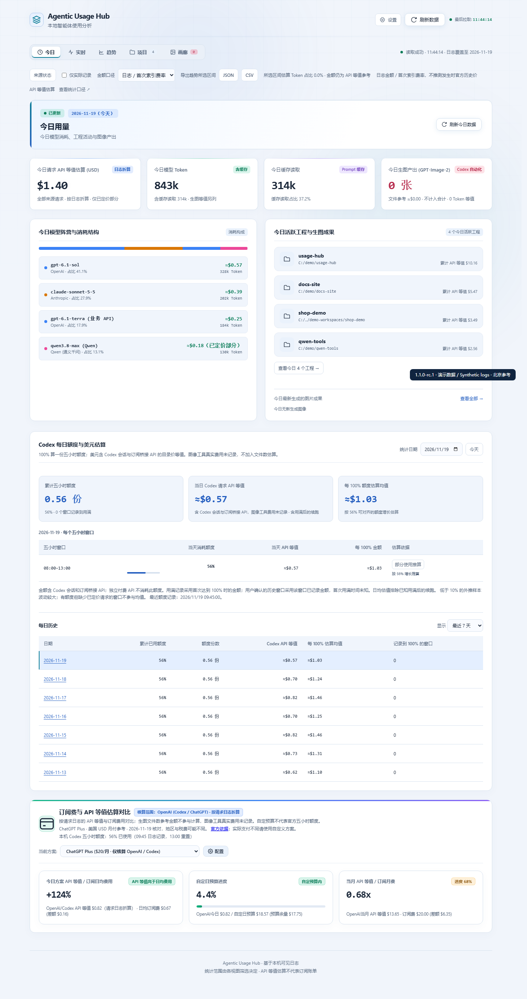
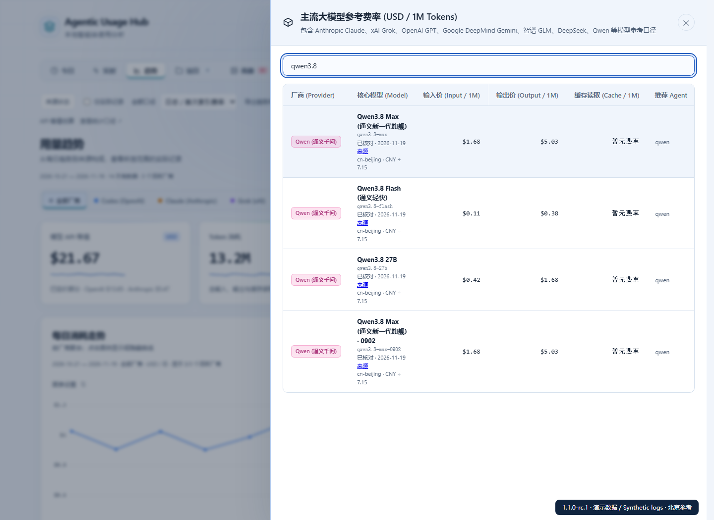

# Agentic Usage Hub — 多智能体统一计量与可视化看板

稳定版升级与配置迁移见 [升级说明](docs/UPGRADING.md)，已验证的数据来源范围见 [来源支持表](docs/SOURCE_SUPPORT.md)。候选版状态见 [变更记录](CHANGELOG.md)。

<p align="center">
  <b>面向 OpenAI Codex · Anthropic Claude · xAI Grok · 智谱 ZCode · Google Antigravity · DeepSeek · 通义千问 Qwen · QoderWork CN 全生态 AI 编程智能体的统一 Token 计量、成本折算与本地工程归因看板</b>
</p>

<p align="center">
  <a href="README.md"><b>简体中文</b></a> | <a href="README_EN.md"><b>English</b></a>
</p>

<p align="center">
  <a href="https://github.com/wangx1ao2/agentic-usage-hub/actions/workflows/ci.yml">
    
  </a>
  <a href="https://nodejs.org"></a>
  <a href="https://www.npmjs.com/package/agentic-usage-hub"></a>
  <a href="https://www.npmjs.com/package/agentic-usage-hub"></a>
  <a href="LICENSE"></a>
</p>

---

## 📸 界面预览 (Screenshots)

<p align="center">
  <b>全景时间走势看板 (Timeline Dashboard)</b><br>
  <i>支持按厂商、按模型双维度多维下钻，支持对数标尺与自定义区间分析</i><br>
  
</p>

<p align="center">
  <b>今日实时消耗与 Agent 构成 (Today Live)</b><br>
  <i>跨厂商聚合今日大模型活跃吞吐、Prompt 缓存复用率与生图资产构成</i><br>
  
</p>

<p align="center">
  <b>模型参考价目矩阵抽屉 (Pricing Matrix Drawer)</b><br>
  <i>内置多厂商模型参考费率与模糊检索；实际价格请以服务商账单为准</i><br>
  
</p>

---

## 🌟 项目简介

在现代 AI 辅助研发工作中，开发者通常组合使用多种 Agent 编程助手（如 OpenAI Codex CLI、Claude Code、xAI Grok CLI、智谱 AI ZCode、Google Antigravity/Gemini、DeepSeek OpenClaw/Reasonix、通义千问 Qwen Code、QoderWork CN 以及 Codex 原生生图工具）。由于各工具的计费机制、缓存策略、日志存放路径及数据格式高度异构，传统工具往往难以提供全生命周期的统一视图。

**Agentic Usage Hub** 是一套轻量、高性能、零第三方重框架依赖的本地全景监控面板：
- **多模型成本参考**：内置 Anthropic、xAI、OpenAI、Google、DeepSeek、智谱与 Qwen 等模型的参考费率，区分输入、输出与缓存读取；未知模型保留 Token 并显示暂无费率，金额仅供趋势比较，具体费率需与服务商核对；
- **今日实时看板 (Today Live)**：跨厂商聚合今日大模型活跃吞吐与生图工具（`GPT-Image-2`）的实时构成；
- **全景时间走势图 (Timeline & Chart.js)**：支持「🏢 按厂商大类」与「🧬 按核心模型」双维度自由切换，提供对数刻度、自定义 Y 轴缩放、区间预设与明细表格检索；
- **本地工程归因 (Projects Attribution)**：按会话记录的工作目录归因；使用完整规范化路径区分同名工程，不按名称关键词合并；
- **生图资产 Studio 画廊**：增量检索 Codex 自动化生成的图片资产与 Prompt，支持灯箱大图预览；
- **模型参考价目矩阵**：前端内置交互式价目抽屉，支持按模型名和厂商搜索；
- **双主题自适应**：支持跟随系统（`prefers-color-scheme`）自适应切换，并提供一键手动控制（自动 / 浅色 / 深色）。

---

## ❓ 常见问题 (FAQ)

- **为什么要统计 AI 编程智能体的 Token 用量？** —— 订阅与 API Key 分散在各家，Token 烧了多少在账单来之前完全不可见。统一视图能把"AI 花费"变成可度量的工程指标。
- **如何查看 Claude Code / Codex CLI 的用量及成本参考值？** —— 运行 `npx agentic-usage-hub`，它会以只读方式解析本地会话日志，并显示日志金额或按模型目录价折算的 API 等值估算。订阅实际账单、赠送额度和折扣不由此推算。
- **支持哪些 AI 编程智能体？** —— OpenAI Codex CLI（含 GPT-Image-2 生图资产）、Anthropic Claude Code、xAI Grok CLI、Google Antigravity / Gemini、DeepSeek OpenClaw / Reasonix、智谱 AI ZCode、通义千问 Qwen Code（`~/.qwen/projects` 会话日志与 DashScope 计量日志）、QoderWork CN / Qoder（`~/.qoderworkcn/projects` 会话日志）；适配器接口清晰，新增 Agent 成本很低。
- **QoderWork CN 是积分计费，Token 数怎么统计？** —— QoderWork 本地日志中的 token 计数字段被打码为 0（积分制），看板采用「正文估算」口径：按会话 jsonl 中消息正文长度折算 Token（输入按累计上下文、输出按响应正文，并对同一 `message.id` 去重），再按 2026-09 阿里云百炼 Qwen3.8 目录价（CNY÷7.15 折美元）展示成本，所有相关数字均带「估算」标识。该口径为近似值，不追求与平台积分账目逐一对账，只用于横向观察用量趋势。
- **与 ccusage 有什么区别？** —— ccusage 也支持多个编程 Agent 的本地用量统计，并可输出表格或 JSON。本项目从 ccusage 的按 Agent 明细中读取 Codex、Claude、Grok，再用独立适配器处理其他来源，提供浏览器看板、工程归因、生图画廊与 MCP 查询。
- **如何作为 MCP Server 接入 Claude Code 或 Cursor？** —— 运行 `npx agentic-usage-hub --mcp` 即可启动标准 Model Context Protocol (MCP) 服务，向 AI 助手暴露 `get_usage_today`、`get_usage_range`、`get_project_breakdown` 三大工具，允许你在对话中直接询问“我今天消耗了多少 Token”、“哪个项目最烧钱”。
- **我的数据会离开本机吗？** —— 核心用量统计只读本地日志，可离线运行，无遥测上报，无需 API Key。可选账号额度查询默认关闭；显式设置 `CODEX_ACCOUNT_QUOTA_ENABLED=1` 后，使用已登录的 Codex CLI 联网读取账号额度，不发送提示词、回复或项目日志。首次通过 npm/npx 下载程序需要网络。
- **如何把 Token 消耗归因到具体项目？** —— 优先读取会话中的工作目录，以规范化完整路径作为项目身份；来源缺少目录时，使用其日志目录或未命名会话组。工程成本也是估算值。

---

## 🏗️ 架构与目录结构

数据链路为 `原始日志 → 适配器/索引 → 统一用量记录 → 查询服务 → HTTP/MCP → 视图`。历史扫描与 SQLite 查询在 Worker 中执行；实时页使用独立的短窗口增量读取。新输入、缓存读取、缓存写入和输出分别保存，推理输出不重复累加。工程、日期、模型和来源汇总复用同一记录集。请求快照不能与日汇总核对时，保留日汇总为“未归因用量”，不按比例猜测工程消耗。

```text
agentic-usage-hub/
├── .github/workflows/ci.yml # GitHub Actions 持续集成自动化测试工作流
├── bin/                     # CLI 全局运行入口 (npx agentic-usage-hub)
│   └── agentic-usage-hub.js
├── mcp/                     # Model Context Protocol (MCP) 服务模块
│   └── server.js            # Stdio JSON-RPC 2.0 服务端与工具暴露
├── docs/                    # 项目文档与高清预览资源
│   └── images/              # 界面效果图与 Social Preview 卡片
├── unified-server.js        # 核心 Node.js 原生 HTTP 服务与路由调度
├── models-pricing.js        # 统一模型定价矩阵、Fuzzy 模糊规整与厂商识别引擎
├── antigravity-adapter.js   # Google Antigravity / Gemini 3.7 Flash 本地日志解析适配器
├── codex-image-adapter.js   # Codex GPT-Image-2 生图资产增量索引与 Prompt 提取
├── openclaw-adapter.js      # DeepSeek / Claude / Grok (OpenClaw / Reasonix) 历史轨迹调用解析
├── qwen-adapter.js          # 通义千问 Qwen Code (~/.qwen) 会话与 DashScope 计量日志解析
├── qoderwork-adapter.js     # QoderWork CN (~/.qoderworkcn) 会话日志正文估算适配器
├── project-adapter.js       # 按工作目录路径进行工程归因
├── lib/                     # 统一记录、查询服务、后台索引、价格快照与导出
├── zcode-adapter.js         # 智谱 AI (Z.ai) SQLite 数据库直读与双计费定价计算
├── .env.example             # 环境变量配置模板
├── .gitignore               # Git 忽略规则 (node_modules, 敏感文件, 缓存)
├── package.json             # 项目元数据与 npm 脚本 (start, test, daily, monthly)
├── public/                  # 静态前端 SPA 应用
│   ├── index.html           # 前端 SPA 骨架与面板容器
│   ├── app.js               # ES Modules 启动与视图协调
│   ├── api.js / state.js    # 请求、错误处理与共享状态
│   ├── insights.js          # 来源诊断、工程下钻、价格版本与导出
│   ├── timeline.js / today.js / projects.js # 按视图拆分的渲染模块
│   ├── styles.css           # 双主题 Design Tokens、Glassmorphism 布局与响应式样式
│   └── chart.umd.js         # 本地化 Chart.js 库
└── tests/                   # 自动化集成与单元测试套件
    ├── api.test.js          # REST API 端点、边界条件、错误处理与安全防御测试
    ├── adapters.test.js     # 各厂商适配器解析、计费公式与数据结构测试
    ├── qwen.test.js         # Qwen Code 夹具、定价模糊匹配与聚合过滤测试
    ├── qoderwork.test.js    # QoderWork CN 正文估算、去重与工程归因测试
    └── mcp.test.js          # MCP 协议握手、工具发现与执行测试
```

---

## 🚀 快速启动

### 方式一：npx 免安装直接运行（推荐 ⚡）

无需手动克隆代码仓库，只要电脑中安装了 Node.js (v20+)，在终端中直接运行：

```bash
# 启动看板 (默认端口 4242)
npx agentic-usage-hub

# 或指定端口并在启动后自动在浏览器打开页面
npx agentic-usage-hub -p 4242 -o

# 全局安装备选方式
npm install -g agentic-usage-hub
agentic-usage-hub -o
```

启动完成后，直接在浏览器中访问：👉 **`http://localhost:4242`**

### 方式二：作为 MCP Server 接入 AI 编程工具 🤖

本项目原生内置了遵循 **Model Context Protocol (MCP)** 标准的 Stdio 服务。你可以在 Claude Code、Cursor、Windsurf 或 Claude Desktop 中将其配置为 MCP Server：

```json
{
  "mcpServers": {
    "agentic-usage-hub": {
      "command": "npx",
      "args": ["-y", "agentic-usage-hub", "--mcp"]
    }
  }
}
```

配置完成后，AI 助手即可调用以下内置工具：
- `get_usage_today`: 实时获取今日各 Agent 的 Token 吞吐、Prompt 缓存命中与美元成本估算；
- `get_usage_range`: 按日期区间统计历史消耗，支持按厂商（OpenAI、Anthropic 等）或按核心模型聚合；
- `get_project_breakdown`: 获取各本地工程路径的消耗归因排行榜。

### 方式三：Git 源码安装

```bash
# 1. 克隆代码仓库
git clone https://github.com/wangx1ao2/agentic-usage-hub.git
cd agentic-usage-hub

# 2. 安装基础依赖
npm install

# 3. 启动统一看板服务 (默认监听 4242 端口)
npm start
```

### 命令行参数 (CLI Flags)

| 参数 | 缩写 | 默认值 | 作用说明 |
| :--- | :--- | :--- | :--- |
| `--port <port>` | `-p` | `4242` 或 `$PORT` | 自定义 HTTP 监听端口 |
| `--open` | `-o` | `false` | 服务就绪后自动调用系统默认浏览器打开大屏 |
| `--mcp` | - | `false` | 启动 Model Context Protocol (MCP) Stdio 服务，供 AI 工具调用 |
| `--version` | `-v` | - | 打印当前安装版本号 |
| `--help` | `-h` | - | 输出帮助指南与支持的模型列表 |

### 环境变量配置（可选）
项目开箱即用，无需配置即可自动读取用户目录下的默认 Agent 日志。如需自定义端口或日志路径：
```bash
cp .env.example .env
```
支持配置项：
- `PORT`: HTTP 监听端口（默认 `4242`）
- `AGENTIC_CACHE_DIR`: 派生缓存与价格快照目录（默认 `~/.cache/agentic-usage-hub`）
- `CODEX_HOME`: Codex 根目录（默认 `~/.codex`）
- `CLAUDE_SESSIONS_DIR` / `ZCODE_DB_PATH` / `ANTIGRAVITY_SESSIONS_DIR`: 覆盖原始日志或数据库位置，默认路径见 `.env.example`
- `HOST`: HTTP 监听地址（默认 `127.0.0.1` 仅本机可访问；如需局域网共享显式设为 `0.0.0.0`）
- `CODEX_IMAGE_DIRS`: 自定义 Codex 生图目录路径（可选）
- `OPENCLAW_SESSIONS_DIR`: 自定义 OpenClaw 会话目录（可选）
- `REASONIX_USAGE_FILE`: 自定义 Reasonix 计量日志路径（可选）
- `QWEN_SESSIONS_DIR`: 自定义 Qwen Code 会话目录（默认 `~/.qwen/projects`）
- `QWEN_USAGE_FILE`: 自定义 Qwen / DashScope 扁平计量日志路径（默认 `~/.qwen/usage.jsonl`）
- `QODER_SESSIONS_DIR`: 自定义 QoderWork CN 会话根目录（默认 `~/.qoderworkcn/projects`，设置后完全覆盖默认路径）
- `QODER_EST_IN_CHARS_PER_TOKEN` / `QODER_EST_OUT_CHARS_PER_TOKEN`: QoderWork 正文估算系数（默认 2.8 / 3.2 字符每 token）
- `QWEN_USD_CNY_RATE`: 百炼 Qwen CNY 目录价折算美元所用汇率（默认 7.15）
- `QWEN_PRICING_REGION`: Qwen 参考地域，默认 `cn-beijing`（中国内地／北京）；另有 `global`、`intl-singapore` 已核对条目，未覆盖的型号不跨地域借价
- `ANTIGRAVITY_USAGE_BIN`: 可选的本地 Antigravity 状态辅助程序路径；未配置时只尝试已安装在项目中的版本，运行时不通过 `npx` 下载

服务端内置零依赖 `.env` 解析器，启动时自动读取项目根目录 `.env`；真实环境变量始终优先于文件配置。

### 运行自动化测试套件
本项目包含 API、适配器、MCP、来源去重、工程路径、Qwen/QoderWork 和路径安全测试。默认串行执行，所有测试使用隔离夹具：
```bash
npm test
```

测试使用隔离的用户目录、日志夹具和缓存，不扫描本机真实会话。`npm run test:ui` 会启动隔离服务并运行浏览器回归（需先安装 Python Playwright 与 Chromium）；`npm run benchmark` 使用约 26 MiB 的 Qwen 日志夹具，验证冷启动、追加刷新与扫描期间的静态请求响应能力。

完整功能建议使用 **Node.js 24+**。服务启动时探测 SQLite 与 Zstandard 能力，`GET /api/capabilities` 返回实际结果；Node.js 20 仍可启动，但缺少 SQLite 时无法读取相关来源，缺少 Zstandard 且存在压缩归档时会保留旧缓存并报告刷新失败。HTTP 与 MCP 共用后台索引 Worker，派生缓存默认写入 `~/.cache/agentic-usage-hub`，可用 `AGENTIC_CACHE_DIR` 覆盖。

历史统计会自动存档到该目录的 `indexes/`：保存每个日志文件的指纹、解析结果、Codex 请求与看板快照。重启后先显示上次看板，再后台核对更新；页面刷新和“刷新数据”都复用未变化文件的结果，只重新解析新增或变化的文件。仍会检查目录清单和文件属性，以发现删除、截断、替换、归档及旧会话续跑，避免漏计或重复计数。ZCode 数据库和 WAL 未变化时复用存档；Codex 的 ccusage 汇总仅在输入变化时重算，并复用历史日志的精简镜像。变化的日志目前按文件重新解析，并非逐字节追加读取。索引使用校验和与原子替换，损坏、解析器或配置变更时自动重建，不修改原始日志或已保存的价格历史。来源诊断中的 `index` 字段提供本次复用文件数、重新解析文件数及读取字节数。

---

## 📡 API 端点规范

### Codex 实时 Token 消耗

独立的 **“实时”页签** 显示 Codex 最近 60 秒的平均 Token/s，分别列出新输入、缓存读取与输出，并展示最近 5 分钟有用量记录的会话、模型及工作目录。新输入已扣除缓存，输出已包含推理 Token，不重复计数。

默认进入“实时”页后每 **2 秒**自动更新，可选 1 秒或 5 秒。提供自动更新开关与“刷新一次”，并记住开关和频率；手动刷新不会改变开关。无近期用量时自动降为至少 5 秒检查，没有日志时至少 10 秒；连续失败逐步退避至最多 30 秒。离开该页或浏览器在后台时暂停，返回后按开关状态恢复。

独立端点 `GET /api/codex-live` 增量读取 `$CODEX_HOME/sessions`（默认 `~/.codex/sessions`）中的新增日志，约每 15 秒发现新建或续跑的会话，不依赖 ccusage 历史聚合缓存。只保留最近 5 分钟的用量与去重记录；没有客户端请求 60 秒后释放实时缓存，不启动持续扫描。无需安装额外程序。设计选择与性能测试见 [实时监控说明](docs/CODEX_LIVE_MONITOR.md)。

**口径：最近 60 秒已记录的请求用量 ÷ 60。** 日志可能在请求完成后才写入，数值是窗口平均消耗，并非流式输出的逐秒生成速度。缓存读取计入总消耗；“近期活跃”仅表示最近 60 秒有用量记录，不检测 Agent 进程，也无法保证识别每个子 Agent。没有日志时显示“未找到会话日志”，读取失败时提示错误；已有日志但窗口内没有用量时显示 0。

**生图任务单独观察。** 实时 Token/s 只统计日志中的 Codex 对话请求，不能代表生图工具内部的实际消耗。当前本地生图记录没有真实图像 Token，面板显示“图像 Token/s —”，并独立展示最近 60 秒／5 分钟的新 PNG 文件数和最近写入时间，图片目录每 15 秒检查。等待生图时对话 Token/s 可以为 0；已有“每张 20K Token 等值”是人为换算，不计入实时实际 Token/s。

| 路径 | 方法 | 说明 | 关键参数 |
| :--- | :--- | :--- | :--- |
| `/api/dashboard` | `GET` | 获取看板全量聚合数据 | `tier`: `standard` \| `flagship`<br>`agent`: `all` \| `codex` \| `claude` \| `grok` \| `zcode` \| `antigravity` \| `openclaw` \| `qwen` \| `qoderwork` |
| `/api/models-pricing` | `GET` | 获取内置模型价目矩阵与厂商配置 | 无 |
| `/api/codex-live` | `GET` | Codex 最近 60 秒 Token/s、分项计数与近期会话明细 | 无 |
| `/api/projects` | `GET` | 工程列表、按日汇总、最近请求时间、未归因用量 | 下述公共筛选项 |
| `/api/usage-records` | `GET` | 统一记录与筛选后总计；默认 100 条 | 公共筛选项、`offset`、`limit`（1–500） |
| `/api/export` | `GET` | 导出筛选范围内全部记录，不受分页影响 | 公共筛选项、`format=json\|csv`；不接受分页参数 |
| `/api/sources` | `GET` | 各来源路径、状态、错误数、覆盖日期、最后成功读取 | 无 |
| `/api/capabilities` | `GET` | 当前运行时 SQLite、Zstandard 能力及限制 | 无 |
| `/api/refresh` | `GET` | 按来源刷新；部分失败返回 HTTP 207 和各来源结果 | 无 |
| `/api/codex-image` | `GET` | 安全读取 Codex 本地生成的图片 | `path`: 本地图片绝对路径（已做安全目录与扩展名强校验） |

公共筛选项：`startDate` / `endDate`（含首尾的 `YYYY-MM-DD`）、`agent`（另支持 `reasonix`）、`projectId`（API 返回的 ID）、`tier`、`actualOnly=true|false`、`pricingMode=recorded|current`、`pricingVersion`。指定价格版本须同时使用 `current`。看板接口支持来源、档位、实际记录与价格选择；趋势日期由页面筛选。MCP 的日期范围和工程工具也支持来源、日期、档位、实际记录与价格选择。

来源状态面板区分缺少日志、空日志和读取失败；保留旧数据时展示旧数据标记与原来的成功时间。工程卡片可展开按日统计及分页记录。仅查看实际记录会排除 QoderWork、Antigravity 等正文推算的 Token，金额仍可能是目录价估算。

JSON 导出包含 `metadata` 和 `records`；CSV 使用 UTF-8 BOM，第一行为 `metadata,<JSON>`，第二行为列名，其后为记录。元数据带服务器时区、时间戳单位（毫秒）、筛选条件、覆盖范围、新鲜度及价格版本；记录带估算依据与 `dateBasis`。缺少精确时间时仅保留日期；QoderWork 可使用文件修改日、Antigravity 可沿用会话最近已知日期，均显式标注并计入日期缺失诊断。导出不包含会话正文；模型名、工程路径等文本会防护 CSV 公式解释。

### 模型价格

默认 `recorded` 保留日志金额或首次索引时捕获的估算值；费率目录以内容哈希保存版本，不能据此推测请求发生时的官方历史价。`current` 按当前或已保存的目录重算，同步作用于看板、工程、额度美元历史和导出。价格缓存损坏、写入失败或并发锁冲突时显式提示；原始日志不受影响。全部金额未知时保存为 `null`；部分费率未知时保存已知小计、`costComplete=false` 和受影响的 `unpricedTokens`，不把缺失部分当作免费。来源元数据在持久化时共享保存，查询与导出仍还原完整依据。

单位为 USD / 百万 token。2026-11-19 的目录审查区分 72 条已核对参考、5 条有官方发布依据的历史参考、19 条无法核实的旧参考、4 条需指定提供商的模型及审批估算配置。无法核实的参考保留 Token、金额未知；已保存的旧金额与目录版本仍可恢复。Qwen 默认北京参考价，保存人民币原价，并按 `QWEN_USD_CNY_RATE`（默认 7.15）换算；这是配置假设，不是实时汇率。单位价格不提前舍入到三位小数，最终请求金额统一到六位小数。价目抽屉可查看每行的核对状态、地域和来源。

Qwen 的输入档位按单次请求计算。缓存模式、思考模式或控制台专属费率缺失时，仅计已知部分；Qwen3.8 Max/Flash 的缓存命中价未从公开文档核实，保持未知。Qwen3.7 Plus 别名的限时优惠与日期快照分别保存，不用别名优惠价覆盖快照；未核对的快照不模糊借价。修改地域或汇率后重启，已有捕获金额继续保留；旧记录没有保存来源时，不补填当前目录为历史依据。

具有完整请求明细时，按型号处理长输入和已核对的服务档位：GPT-5.4/5.5/5.6 与 GPT-6 已列型号使用 272K 门槛，Gemini 2.5 Pro 使用 200K，Grok 已列新型号从 200K 起，Haiku 5.5 使用 100K。日汇总不会被当作一次长请求。Claude 缓存写入需日志中的 5 分钟/1 小时拆分；实际响应的 `usage.speed` 与 `usage.inference_geo` 用于支持型号的快速模式和美国地域计价。未知或矛盾档位保留未知。Gemini 2.5 批处理不折扣缓存读，已核对的 3.x 则按官方半价处理。GPT-5.6 Sol 优惠和 Gemini 2.5 旧路由参考价截至 2026-11-30，3.8/3.6 Flash 优惠参考截至 2026-12-31；过期后“current”返回未知，已捕获金额保留，显式旧快照按捕获日期重算。

这些金额为文本 API 参考估算，不含缓存存储、工具、税费、地区附加费和真实订阅扣费。GPT-Image-2 因本地图片缺少请求参数，仍单独按中等画质 1024×1024 输出示例 $0.053/张估算。新目录快照同时保存价格、规则和来源；旧快照保持原有运算口径。

核对来源：[OpenAI](https://developers.openai.com/api/docs/pricing)、[Anthropic](https://platform.claude.com/docs/en/about-claude/pricing)、[xAI](https://docs.x.ai/developers/pricing)、[Google](https://aistudio.google.com/docs/pricing)、[DeepSeek](https://api-docs.deepseek.com/quick_start/pricing/)、[Z.AI](https://docs.z.ai/guides/overview/pricing)、[阿里云百炼](https://help.aliyun.com/zh/model-studio/model-pricing)。

---

## 🛡️ 安全与健壮性设计

1. **零外部网络泄露与无凭证依赖**：
   - 本看板为纯本地运行的遥测聚合器，不依赖任何第三方线上上报服务器，不向外网发送代码或会话敏感信息；可选的 Antigravity 状态辅助程序需要预先安装在本机；
   - 无需在看板中配置任何 API Key 或密码即可启动。
2. **默认仅监听本机回环地址**：
   - HTTP 服务默认绑定 `127.0.0.1`（可通过 `HOST` 环境变量显式放开），局域网其他主机无法直接访问；
   - CORS 仅放行 `localhost / 127.0.0.1` 来源，阻断公网网页在浏览器内跨站读取本地用量数据。
3. **路径遍历防御 (Path Traversal Protection)**：
   - `/api/codex-image` 使用 `path.relative` 严格包含性校验（杜绝 `startsWith` 前缀混淆），`generated_images` 仅认可真实目录层级而非任意子串，且只放行图片扩展名；
   - 静态资源服务器强制限制在 `public/` 目录范围内，越界请求直接返回 `403 Forbidden`。
4. **全局错误边界与兜底**：
   - 服务端所有路由封装统一的 `try...catch`，恶意/畸形 URL 直接返回 `400`，避免任何单点异常使服务挂起；
   - 前端所有本地日志派生字符串（工程路径、模型名、生图 Prompt）在 DOM 渲染前统一 HTML 转义；
   - 图像资源加载失败时自动应用轻量 SVG 占位图兜底。
5. **多级高性能缓存与故障退避**：
   - 磁盘级增量时间戳比对缓存（避免重复全量读取数 GB 日志）；
   - 服务端 10s 内存响应缓存（削峰填谷，降低高频请求压力）；
   - 外部 CLI（ccusage）调用失败时自动进入 60s 冷却退避，避免每次请求阻塞数十秒。
6. **QoderWork CN 正文零留存**：
   - 适配器读取会话 jsonl 时仅对消息内容做**长度统计**（字符数），不解析、不缓存、不输出任何提示词、回复正文或工具调用参数；
   - 对外 API 只暴露日期、模型名与数值计数；项目归因仅使用工作目录路径名，与其余 Agent 的本地展示口径一致。

---

## 🔍 已知范围与使用说明 (Scope & Limitations)

- **只读分析**：本工具为只读遥测分析看板，不会修改您的任何 Agent 原始会话日志、SQLite 数据库或工程源代码；
- **环境依赖**：各 Agent 历史数据的丰富程度取决于您本机已使用的编程助手（如未在本地运行过 Claude Code 或 Grok CLI，对应厂商的数据将显示为待使用状态，一旦运行将自动被检索聚合）。
- **QoderWork CN 为估算口径**：因平台积分计费将本地日志 token 计数打码为 0，QoderWork 相关 Token 与美元成本均为正文估算值（输入按累计上下文重复发送、缓存近似恒命中折算），仅供趋势参考，不与平台积分账目对账；Night Plan 折扣、套餐内赠送额度等促销因素未纳入折算。
- **工程归因环境要求**：Codex 按请求日志关联工程，不依赖 SQLite；ZCode 数据库来源需要 `node:sqlite`。完整运行建议 Node.js 24+，以启动能力探测为准。
- **来源与金额口径**：ccusage 仅采纳 Codex、Claude、Grok 来源，其他来源由本项目适配器处理；Claude 有完整原始记录时优先采用原始记录。金额为日志金额或 API 目录价等值估算，不是订阅账单。工程成本直接来自可核对的请求，缺少工程路径或快照不一致的部分单列未归因。
- **生图费用边界**：图片金额是本地 PNG 文件数乘以 GPT-Image-2 medium 1024×1024 的参考单价，不是逐请求费用；文件数也不等于 API 请求数。它与每张 20K Token 的人为等值换算均不进入今日、趋势、模型族、Agent 汇总或订阅对比。GPT 请求的 Token 折算不能证明已包含图像工具费用；缺少图像 usage 时，完整费用未知。图库保留单独的文件参考金额。
- **Codex 请求计价**：逐请求日志与 ccusage Token 快照严格一致时，使用该型号的请求规则修正上游短上下文估算；无法匹配时保留汇总并标明请求上下文缺失。没有速度记录时使用标准速度参考，只有型号已核实的档位才应用倍率。未知型号及未经核对的显式档位保留未知金额。
- **五小时额度与自定预算**：五小时使用率及重置时间来自本机 Codex 日志，不用美元金额推算；日志快照可能滞后。订阅对比中的默认 $130/周仅为自定 API 等值预算示例，不代表官方订阅额度，也不保证五小时能使用固定美元金额。
- **每日额度与美元历史**：在「今日」页选择日期，查看当日消耗的五小时额度百分比、折合份数、Codex API 等值及窗口明细。用满窗口按首次达到 100% 的请求金额核算；部分窗口按可对齐区间的金额 ÷ 额度增长比例推算每 100% 金额。每日估算均值同样按这些区间加权，不纳入用满后的续跑。跨日窗口只分配当天增长；缺少午夜基线时显示下限，无额度日志时显示“未记录”。只覆盖本机日志，云端、其他设备及未定价请求可能影响完整性。

  金额不完整的区间保留小计和额度观察，但不外推完整的每 100% 美元金额。订阅与自定预算比较会标明已知部分，不据此显示确定的预算余量或完整用量结论。

---

## 📄 许可说明
本项目基于 [MIT License](LICENSE) 开源。

<a href="llms.txt">🤖 llms.txt — 面向 LLM / AI 爬虫的机器可读项目摘要</a>
