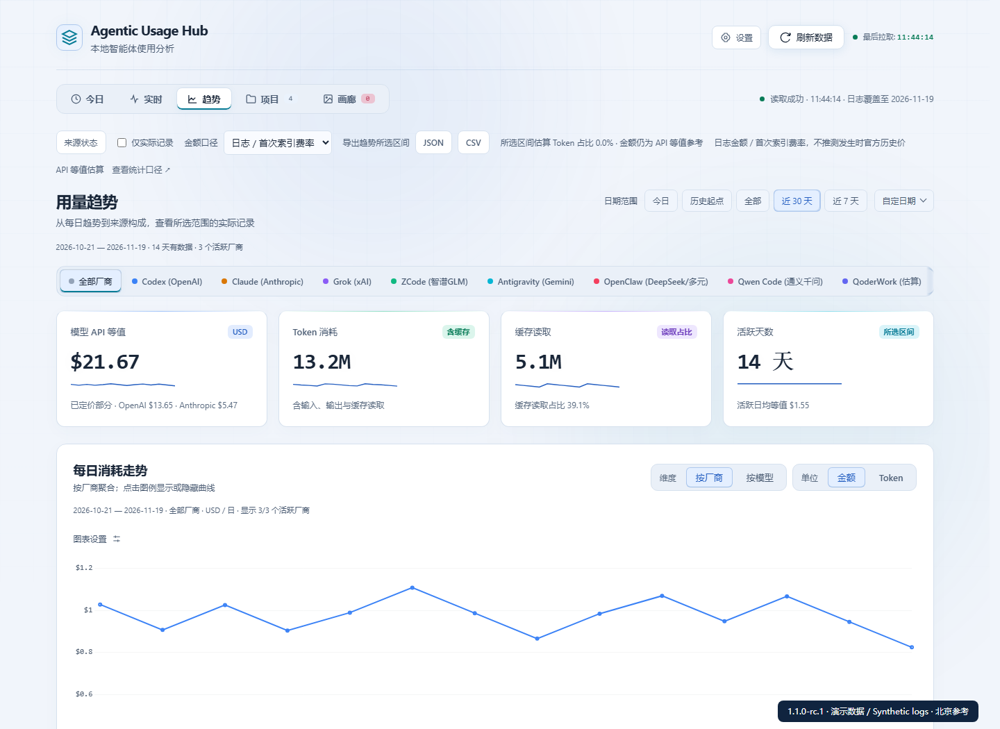
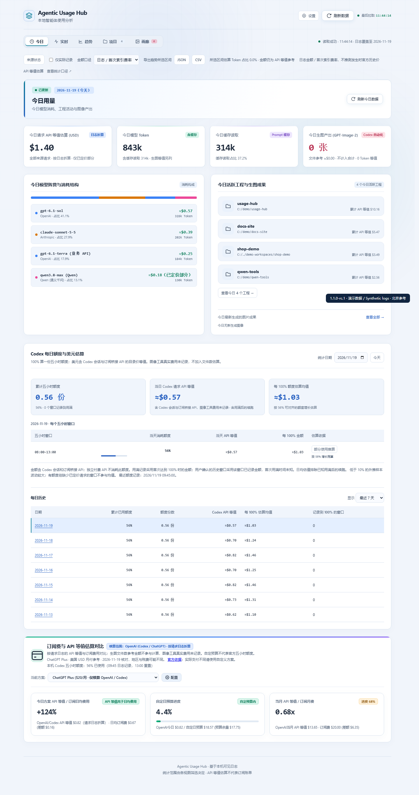
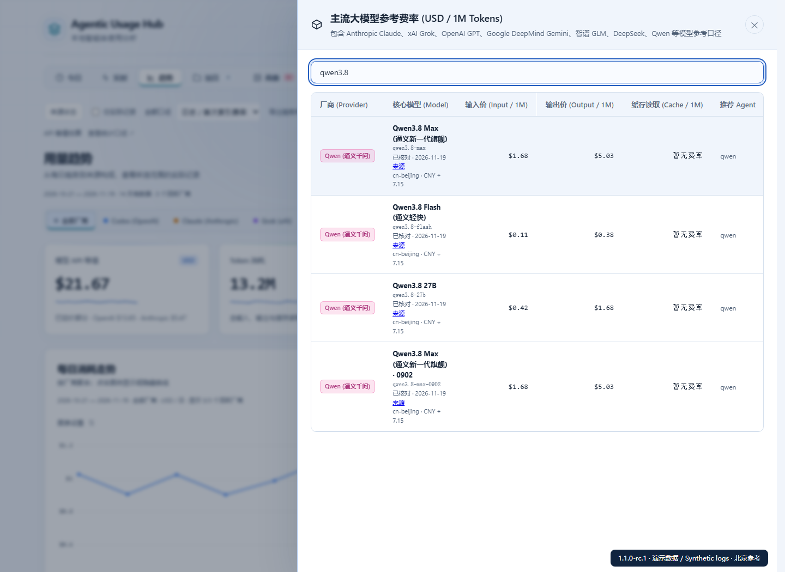

# Agentic Usage Hub — Multi-Agent Token Telemetry & Analytics Dashboard

See [upgrade and migration notes](docs/UPGRADING.md), [source verification boundaries](docs/SOURCE_SUPPORT.md), and [candidate changelog](CHANGELOG.md).

<p align="center">
  <b>Unified token metering, cost estimation, and local workspace attribution for OpenAI Codex · Anthropic Claude · xAI Grok · Zhipu ZCode · Google Antigravity · DeepSeek OpenClaw · Qwen Code · QoderWork CN</b>
</p>

<p align="center">
  <a href="README_EN.md"><b>English</b></a> | <a href="README.md"><b>简体中文</b></a>
</p>

<p align="center">
  <a href="https://github.com/wangx1ao2/agentic-usage-hub/actions/workflows/ci.yml">
    
  </a>
  <a href="https://nodejs.org"></a>
  <a href="https://www.npmjs.com/package/agentic-usage-hub"></a>
  <a href="https://www.npmjs.com/package/agentic-usage-hub"></a>
  <a href="LICENSE"></a>
</p>

---

## 📸 Screenshots & UI Preview

<p align="center">
  <b>Panoramic Timeline Dashboard</b><br>
  <i>Dual-dimensional drilldown (by Provider or by Model), logarithmic scale support, and custom range analysis</i><br>
  
</p>

<p align="center">
  <b>Today Live Telemetry & Agent Composition</b><br>
  <i>Cross-provider breakdown of active token throughput, cache hit rates, and image generation counts</i><br>
  
</p>

<p align="center">
  <b>Interactive Official Pricing Matrix Drawer</b><br>
  <i>Catalog of 6 major AI providers and 20+ frontier models (including Claude Fable 5, Grok 4.6, GPT-5.6) with fuzzy search</i><br>
  
</p>

---

## 🌟 Key Features

In modern AI-assisted software engineering, developers frequently combine multiple coding assistants (such as OpenAI Codex CLI, Claude Code, xAI Grok CLI, Zhipu AI ZCode, Google Antigravity/Gemini, DeepSeek OpenClaw/Reasonix, Qwen Code / Tongyi, and QoderWork CN). Because each tool uses divergent log formats, cache hierarchies, and pricing rules, developers lack a single unified view of their actual consumption.

**Agentic Usage Hub** is a lightweight, high-performance, zero-heavy-framework local telemetry dashboard:

- **Model Cost Reference**: Built-in indicative input, output, and prompt-cache rates; unknown models use a generic fallback. Verify rates with the provider before using them for financial decisions:
  - **Anthropic Claude**: Claude Fable 5 Agent, Claude 4.5 family, 3.7 Sonnet (Hybrid Reasoning), 3.5 Sonnet/Haiku, Opus
  - **xAI Grok**: Grok 4.6 (Vision / Deep Reasoning), Grok 4, Grok 3, Grok 2
  - **OpenAI**: GPT-5.6 family, o3-mini, o1 series, GPT-4o series
  - **Google DeepMind**: Gemini 3.7 Flash, Gemini 2.5 Pro/Flash
  - **DeepSeek**: DeepSeek V4 Pro/Flash, R1 Reasoner, V3 Chat
  - **Zhipu AI**: GLM-5.3 Flagship/Flash, GLM-5.2
  - **Qwen (Tongyi)**: Qwen3-Max, Qwen-Max/Plus/Turbo, Qwen3-Coder Plus/Flash, Qwen3-235B-A22B, Qwen-VL-Max, QwQ-32B
- **Today Live Telemetry**: Aggregates real-time active token throughput across all providers alongside `GPT-Image-2` generation metrics;
- **Interactive Panoramic Timeline (Chart.js)**: Switch seamlessly between **Provider View** (🏢) and **Core Model View** (🧬), featuring logarithmic scaling, customizable Y-axis, date presets, and tabular breakdowns;
- **Local Project Attribution**: Groups sessions by normalized full workspace path, keeping same-named directories distinct;
- **Codex Image Studio**: Incrementally indexes locally generated assets, prompts, and timestamps with lightbox preview;
- **Built-in Pricing Reference Matrix**: Slide-out drawer with fuzzy search for indicative input, cached input, and output rates;
- **Adaptive Dual Theme**: Automatically synchronizes with system dark/light preferences (`prefers-color-scheme`) with one-click manual override (Auto / Light / Dark).

---

## ❓ FAQ

- **Why should I track my AI coding agent token usage?** — Spend is scattered across subscriptions and API keys, so token burn is invisible until the bill arrives. A unified view turns AI spend into a measurable engineering metric.
- **How do I see Claude Code or Codex CLI usage and a cost reference?** — Run `npx agentic-usage-hub`. It reads local logs and shows recorded amounts or API-list-price equivalents. These estimates are not subscription bills and do not account for included credits or discounts.
- **Which AI coding agents are supported?** — OpenAI Codex CLI (including GPT-Image-2 assets), Anthropic Claude Code, xAI Grok CLI, Google Antigravity / Gemini, DeepSeek OpenClaw / Reasonix, Zhipu AI ZCode, Qwen Code (`~/.qwen/projects` session logs plus DashScope usage logs), and QoderWork CN (`~/.qoderworkcn/projects` session logs). The adapter interface makes adding new agents straightforward.
- **How are QoderWork CN tokens measured?** — QoderWork bills in credits and masks the token counters in local logs as 0, so the dashboard uses an *estimated* body-length method: input tokens assume the cumulative conversation context is re-sent per call, output tokens are derived from assistant message length (deduplicated by `message.id`), and cost is converted from the 2026-09 Aliyun Bailian Qwen3.8 CNY catalog prices (÷7.15 to USD). Every related figure is clearly labelled as an estimate for trend analysis, not a billing reconciliation.
- **How is this different from ccusage?** — ccusage already supports multiple coding agents and exports tables or JSON. This project reads its per-agent Codex, Claude, and Grok rows, handles other sources with local adapters, and adds a browser dashboard, project attribution, an image gallery, and MCP tools.
- **How do I use this with Claude Code, Cursor, or Windsurf as an MCP server?** — Run `npx agentic-usage-hub --mcp` to start a standard Model Context Protocol (MCP) server over stdio. It exposes `get_usage_today`, `get_usage_range`, and `get_project_breakdown` tools so your AI coding assistant can directly answer "What did I spend on AI today?" or "Which project is burning the most tokens?".
- **Does any of my data leave my machine?** — Core statistics read local logs offline, with no telemetry or API key. Optional account quota reads are disabled by default; `CODEX_ACCOUNT_QUOTA_ENABLED=1` uses the signed-in Codex CLI to query account limits online without sending prompts, responses or project logs. Initial npm/npx downloads require a connection.
- **How do I attribute usage to a project?** — The attribution engine prefers the session's working directory and uses its full normalized path as project identity. When a source has no workspace path, it falls back to its log directory or an unnamed-session group. Project costs are estimates.

---

## 🏗️ Architecture & Directory Structure

The pipeline is `logs → adapters/index → canonical usage records → query service → HTTP/MCP → views`. Historical scans and SQLite queries run in a worker; Live uses a separate short-window incremental reader. Fresh input, cache reads, cache writes and output have separate fields. Projects and all day/model/source rollups use the same ledger. Request details that cannot be reconciled with aggregate counters stay explicitly unattributed; costs are never allocated to projects by assumed token ratios.

```text
agentic-usage-hub/
├── .github/workflows/ci.yml # GitHub Actions continuous integration workflow
├── bin/                     # Global CLI executable (npx agentic-usage-hub)
│   └── agentic-usage-hub.js
├── mcp/                     # Model Context Protocol (MCP) server module
│   └── server.js            # Stdio JSON-RPC 2.0 server & tool handlers
├── docs/                    # High-resolution screenshots and documentation
│   └── images/              # Dashboard captures & social preview card
├── unified-server.js        # Core native Node.js HTTP server and router
├── models-pricing.js        # Unified model pricing matrix, fuzzy matching, and provider resolver
├── antigravity-adapter.js   # Google Antigravity / Gemini 3.7 Flash log adapter
├── codex-image-adapter.js   # Codex GPT-Image-2 asset indexing and prompt parser
├── openclaw-adapter.js      # DeepSeek / Claude / Grok (OpenClaw / Reasonix) trajectory parser
├── qwen-adapter.js          # Qwen Code (~/.qwen) session & DashScope usage log parser
├── qoderwork-adapter.js     # QoderWork CN (~/.qoderworkcn) session logs with estimated token metering
├── project-adapter.js       # Workspace-path project attribution
├── lib/                     # Canonical records, query worker, pricing history and exports
├── zcode-adapter.js         # Zhipu AI (Z.ai) SQLite reader and dual-pricing estimator
├── .env.example             # Environment variable configuration template
├── .gitignore               # Standard Git ignore rules
├── package.json             # Package metadata and npm scripts
├── public/                  # Frontend SPA (Vanilla JS + Glassmorphism CSS)
│   ├── index.html           # SPA container
│   ├── app.js               # Native ES Modules bootstrap and view coordination
│   ├── api.js / state.js    # Requests, errors and shared state
│   ├── insights.js          # Diagnostics, project details, pricing versions and exports
│   ├── timeline.js / today.js / projects.js # View modules
│   ├── styles.css           # Design tokens, CSS variables, and layout
│   └── chart.umd.js         # Vendored Chart.js library
└── tests/                   # Automated integration and unit test suite
    ├── api.test.js          # REST API endpoints, validation, and security test cases
    ├── adapters.test.js     # Provider adapters, pricing calculations, and parsing tests
    ├── qwen.test.js         # Qwen Code adapter fixtures, pricing fuzzy-match, and API filters
    ├── qoderwork.test.js    # QoderWork CN estimated-token adapter, dedup, and attribution tests
    └── mcp.test.js          # MCP protocol handshake, tool discovery & execution tests
```

---

## 🚀 Quick Start

### Method 1: Instant Launch with npx (Recommended ⚡)

No need to clone the repository. If you have Node.js (v20+) installed, simply run:

```bash
# Launch dashboard on default port 4242
npx agentic-usage-hub

# Or specify a custom port and automatically open default browser
npx agentic-usage-hub -p 4242 -o

# Optional global installation
npm install -g agentic-usage-hub
agentic-usage-hub -o
```

Once running, open: 👉 **`http://localhost:4242`**

---

### Method 2: Connect as an MCP Server (Claude Code, Cursor, Windsurf) 🤖

Agentic Usage Hub provides a native Model Context Protocol (MCP) server over stdio. Configure it directly in your AI assistant:

```json
{
  "mcpServers": {
    "agentic-usage-hub": {
      "command": "npx",
      "args": ["-y", "agentic-usage-hub", "--mcp"]
    }
  }
}
```

Available tools exposed to your AI:
- `get_usage_today`: Real-time cross-agent token throughput, prompt cache hit rate, and USD cost breakdown for today;
- `get_usage_range`: Historical consumption aggregated by provider (OpenAI, Anthropic, Google, etc.) or by model for any date range;
- `get_project_breakdown`: Local workspace project rankings sorted by token volume and USD cost.

---

### Method 3: Git Clone & Source Run

```bash
# 1. Clone repository
git clone https://github.com/wangx1ao2/agentic-usage-hub.git
cd agentic-usage-hub

# 2. Install dependencies
npm install

# 3. Start unified dashboard server
npm start
```

---

### CLI Flags & Options

| Option | Shorthand | Default | Description |
| :--- | :--- | :--- | :--- |
| `--port <port>` | `-p` | `4242` or `$PORT` | Custom HTTP server listening port |
| `--open` | `-o` | `false` | Automatically launch default browser upon server ready |
| `--mcp` | - | `false` | Start Model Context Protocol (MCP) stdio server |
| `--version` | `-v` | - | Print current version number |
| `--help` | `-h` | - | Display CLI usage manual and options list |

---

### Environment Configuration (Optional)

The dashboard works out-of-the-box with default user directory log paths. To customize paths or ports:

```bash
cp .env.example .env
```

Available variables:
- `PORT`: HTTP server port (default: `4242`)
- `AGENTIC_CACHE_DIR`: Derived caches and pricing snapshots (default: `~/.cache/agentic-usage-hub`)
- `CODEX_HOME`: Codex root (default: `~/.codex`)
- `CLAUDE_SESSIONS_DIR` / `ZCODE_DB_PATH` / `ANTIGRAVITY_SESSIONS_DIR`: Override source locations; defaults are listed in `.env.example`
- `HOST`: HTTP bind address (default: `127.0.0.1`, local-only; set `0.0.0.0` to share on your LAN)
- `CODEX_IMAGE_DIRS`: Custom Codex image directories, separated by the platform path delimiter (optional)
- `OPENCLAW_SESSIONS_DIR`: Custom OpenClaw session storage directory (optional)
- `REASONIX_USAGE_FILE`: Custom Reasonix telemetry log path (optional)
- `QWEN_SESSIONS_DIR`: Custom Qwen Code projects directory (default: `~/.qwen/projects`)
- `QWEN_USAGE_FILE`: Custom Qwen / DashScope flat usage log file (default: `~/.qwen/usage.jsonl`)
- `QODER_SESSIONS_DIR`: Custom QoderWork CN sessions root (default: `~/.qoderworkcn/projects`; fully overrides the default when set)
- `QODER_EST_IN_CHARS_PER_TOKEN` / `QODER_EST_OUT_CHARS_PER_TOKEN`: QoderWork estimation factors (characters per token, defaults 2.8 / 3.2)
- `QWEN_USD_CNY_RATE`: CNY→USD exchange rate used to convert Bailian Qwen catalog prices (default 7.15)

The server parses `.env` natively with a zero-dependency loader — real environment variables always take precedence over the file.

---

### Running Automated Tests

The repository includes API, adapter, MCP, source selection, project-path, Qwen/QoderWork, and path-security tests. The default runner executes isolated fixtures serially:

```bash
npm test
```

Tests use isolated home directories, log fixtures and caches rather than personal agent history. `npm run test:ui` starts an isolated server and runs browser regressions (Python Playwright and Chromium must be installed). `npm run benchmark` measures cold indexing, append refresh and static-request responsiveness with a roughly 26 MiB Qwen fixture.

Use **Node.js 24+ for full functionality**. Startup probes SQLite and Zstandard; `GET /api/capabilities` reports actual runtime support. Node.js 20 can still start the dashboard, but SQLite sources are unavailable without that capability; compressed archives require Zstandard, otherwise refresh retains old data and reports failure. HTTP and MCP share a background indexing worker. Derived caches default to `~/.cache/agentic-usage-hub`, configurable with `AGENTIC_CACHE_DIR`.

History is automatically saved under `indexes/`, including file fingerprints, parsed contributions, Codex requests and dashboard snapshots. A restart displays the saved dashboard while verifying updates in the background. Both page reloads and **Refresh data** reuse unchanged files; only new or changed log files are parsed again. Directory inventories and file attributes are still checked to detect deletions, truncation, replacement, archives and resumed sessions. Unchanged ZCode databases/WALs reuse saved results. Codex reruns its ccusage aggregate only when inputs change, using the existing compact log mirrors. Changed logs are reparsed at file granularity, rather than read as byte-level appends. Checksums and atomic replacement protect derived indexes; corrupt indexes or parser/configuration changes trigger a rebuild without changing original logs or pricing history. Source diagnostics expose reused/parsed file counts and bytes read in `index`.

---

## 📡 REST API Reference

### Live Codex token consumption

The dedicated **Live tab** shows Codex's rolling 60-second average in tokens/s, split into fresh input, cache reads, and output, with session/model/workspace details for sessions with usage in the last five minutes. Cache reads are subtracted from fresh input; reasoning tokens are already included in output.

Automatic updating defaults to every 2 seconds while Live is visible, with 1s/2s/5s options, a remembered on/off switch, and a one-time refresh button that preserves the switch. Idle checks slow to at least 5 seconds, missing logs to at least 10 seconds, and consecutive failures back off to at most 30 seconds. Leaving Live or hiding the browser suspends requests; returning resumes only if automatic updating is enabled.

`GET /api/codex-live` reads appended logs under `$CODEX_HOME/sessions` (default `~/.codex/sessions`) independently of historical ccusage caches, discovering new or resumed sessions approximately every 15 seconds. Only five minutes of usage/deduplication records are retained. After 60 seconds without clients, live caches are released without background scanning. No additional installation is needed.

The rate is **logged request usage in the last 60 seconds divided by 60**, including cache reads. Usage may be logged after a request completes; this measures average consumption rather than streaming generation speed. Recent activity means usage recorded in the last 60 seconds, not a running process, and individual subagents may not be distinguishable. Missing/unreadable logs are reported separately from an idle zero.

Image generation is displayed separately: local image-tool records do not expose actual image tokens, so image tokens/s is shown as unavailable. A lightweight directory scan every 15 seconds reports new local PNG files in the last minute/five minutes and the latest write time. Conversation tokens/s can be zero while image generation continues. The historical 20K-token-per-image equivalent is an artificial conversion and is never counted as actual live tokens/s.

| Endpoint | Method | Description | Parameters |
| :--- | :--- | :--- | :--- |
| `/api/dashboard` | `GET` | Retrieve complete aggregated telemetry data | `tier`: `standard` \| `flagship`<br>`agent`: `all` \| `codex` \| `claude` \| `grok` \| `zcode` \| `antigravity` \| `openclaw` \| `qwen` \| `qoderwork` |
| `/api/models-pricing` | `GET` | Retrieve built-in model catalog, price rates, and brand colors | None |
| `/api/projects` | `GET` | Workspace totals, daily usage, activity timestamps and unattributed usage | Shared filters below |
| `/api/usage-records` | `GET` | Canonical records and filtered totals | Shared filters, `offset`, `limit` (1–500; default 100) |
| `/api/export` | `GET` | All records in the filtered scope | Shared filters, `format=json\|csv`; pagination rejected |
| `/api/sources` | `GET` | Source paths, availability, errors, coverage and last successful read | None |
| `/api/capabilities` | `GET` | Actual SQLite/Zstandard runtime capabilities | None |
| `/api/refresh` | `GET` | Refresh each source; HTTP 207 and individual results on partial failure | None |
| `/api/codex-image` | `GET` | Securely stream a local image generated by Codex | `path`: Absolute image file path (safeguarded against traversal) |

---

Shared filters: inclusive `startDate` / `endDate` (`YYYY-MM-DD`), `agent` (also `reasonix`), `projectId` (an API-returned ID), `tier`, `actualOnly=true|false`, `pricingMode=recorded|current`, and `pricingVersion`. A saved version requires `current` mode. Dashboard supports source, tier, actual-only and pricing selection; its trend date selection is applied by the page. MCP range/project tools support the same source/date/tier/actual-only/pricing selections.

The Sources panel distinguishes missing logs, empty logs and read failures. Retained snapshots keep their original successful-read time. Project cards open daily totals and paginated records. Actual-only excludes body-based token estimates such as QoderWork and Antigravity; logged token counts may still have estimated dollar amounts.

JSON exports contain `metadata` and `records`. CSV uses a UTF-8 BOM, a `metadata,<JSON>` first row, a column-header second row, and data rows. Metadata carries timezone, millisecond timestamp units, filters, coverage, freshness and pricing versions. Records include estimation evidence and `dateBasis`; date-only evidence never becomes a fabricated request timestamp. Missing QoderWork timestamps may use the file modification day, and Antigravity may inherit the last known session day; both are marked and counted in date diagnostics. Exports omit conversation bodies and guard text cells against spreadsheet formulas.

Default `recorded` pricing preserves logged amounts or first-index estimates. Catalog snapshots are identified by a content hash; they do not establish official prices at request time. `current` recalculates with the current or a saved catalog across dashboards, projects, quota dollar history and exports. Corrupt/unwritable pricing caches and lock conflicts produce an explicit warning without changing source logs. Unknown costs remain `null`; totals contain only priced portions. Unpriced cache writes also mark costs incomplete.

## 🛡️ Security & Privacy Principles

1. **Local statistics and optional online quota reads**:
   - Agentic Usage Hub runs entirely on your local machine.
   - It never transmits your prompts, code, project names, or usage data to any remote third-party service. An optional Antigravity status helper must already be installed locally; the server does not download it at runtime.
   - No credentials are needed for local statistics. Optional online quota reads require a signed-in Codex CLI and explicit opt-in.
2. **Localhost-Only by Default**:
   - The HTTP server binds to `127.0.0.1` out of the box (override with `HOST`), so other LAN machines cannot reach the dashboard;
   - CORS responses only echo `localhost`/`127.0.0.1` origins, preventing remote websites from silently scraping your local usage data through your browser.
3. **Path Traversal Protection**:
   - The `/api/codex-image` endpoint uses strict `path.relative` containment checks against whitelisted directories, recognizes `generated_images` only as a real path segment, and blocks non-image extensions;
   - Static assets are locked to the `public/` directory; malformed request URLs return `400` instead of crashing the handler.
4. **Frontend Output Escaping**: every log-derived string (project paths, model names, image prompts) is HTML-escaped before DOM insertion.
5. **Robust Error Boundaries**:
   - Server endpoints wrap all file I/O and JSON parsing in try-catch guards to prevent unhandled process crashes.
   - The frontend includes offline/network failure banners with one-click retry.
   - Missing or corrupted image files automatically fallback to an inline SVG placeholder.
6. **High-Performance Caching**:
   - Disk mtime timestamp checks skip re-parsing unmutated multi-megabyte log files.
   - An in-memory 10-second response cache eliminates CPU spikes during frequent dashboard reloads.
7. **QoderWork CN Zero Body Retention**: the adapter only measures message-content length (characters) while parsing session jsonl — prompts, replies, and tool arguments are never stored, cached, or exposed; APIs return dates, model names, and numeric counters only.

**Data scope:** ccusage contributes only Codex, Claude, and Grok rows; local adapters handle overlapping sources, and complete direct Claude records take precedence. USD amounts are logged costs or catalog estimates, not subscription bills. Project costs come from reconciled requests; missing paths or unmatched snapshots stay unattributed. Codex attribution uses request logs without SQLite; ZCode requires `node:sqlite`. Node.js 24+ is recommended for full functionality, with actual capabilities probed at startup.

When ccusage reports zero cost for a priced GPT-6 model with nonzero usage, the dashboard estimates an API equivalent from fresh input, cached input, and output tokens and marks it with `≈`. Matching request logs enable long-context pricing above 272K input tokens: 2x input/cache and 1.5x output. Recorded Fast or Ultrafast tiers apply 2x or 6x API pricing; missing speed metadata defaults to Standard. Unmatched token snapshots fall back to short-context estimates. Unknown GPT-6 variants remain unpriced.

Five-hour usage and reset times come from local Codex log snapshots, which may lag. The default $130/week in subscription comparisons is a user budget example, not an official allowance or a guaranteed five-hour dollar value.

The Today page includes daily quota history with a date picker, quota percentages and full-allowance equivalents, API cost estimates, and individual windows. Completed windows use the cost at the first 100% observation; partial windows extrapolate from matching observed usage increments. Daily averages weight those matching intervals and exclude continuation after saturation. Windows crossing midnight contribute only the day's increment; missing baselines show a lower bound and absent quota logs show “not recorded”. Only local logs are covered.

Image amounts are local PNG file counts multiplied by a GPT-Image-2 medium 1024×1024 reference price, not measured request costs. File counts need not equal API request counts. These references and the arbitrary 20K-token conversion per file are excluded from Today, trends, model-family and agent totals, and subscription comparisons. Logged GPT request tokens do not establish that image-tool costs are included; complete costs remain unknown without image usage. The gallery retains a separate file-based reference amount.

---

## 📄 License

This project is licensed under the [MIT License](LICENSE).

<a href="llms.txt">🤖 llms.txt — machine-readable project summary for LLM / AI crawlers</a>
